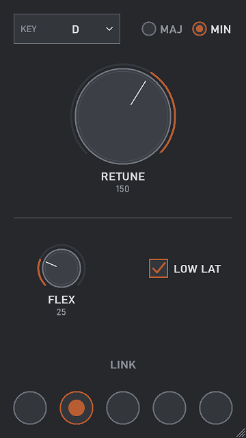
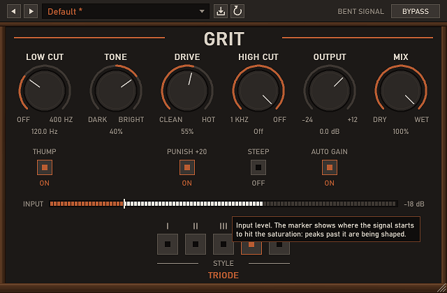

# Bent Signal

A collection of small audio plugins for Windows (VST3), sharing one editor and one DSP crate. Free, MIT. Three so far:

| Plugin | What it is | Download |
|---|---|---|
| **[Plumb](docs/plumb.md)** | Pitch correction. Key, retune speed, flex, low-latency mode, link groups. | `Plumb-VST3-0.3.2-x64.msi` |
| **[Shifter](docs/shifter.md)** | Micro-pitch doubler: one take sounds double-tracked. | `Shifter-VST3-0.3.2-x64.msi` |
| **[Grit](docs/grit.md)** | Five-style drive / saturation. | `Grit-VST3-0.3.2-x64.msi` |

See [Plumb vs the competition](docs/vs-competition.md) for measured comparisons.

## Install

1. Download an `.msi` from the [latest release](../../releases/latest) and run it (needs admin): `BentSignal-VST3-Bundle` installs all three (pick which in the installer), or take one plugin's MSI. Each plugin goes to `C:\Program Files\Common Files\VST3\<Name>.vst3`.
2. Rescan plugins in your DAW.

Windows 10/11, 64-bit, VST3 hosts. To uninstall, use Windows' Apps list. Windows may show a SmartScreen warning because the installers are not code-signed: More info → Run anyway.

## Build

Needs Rust (MSVC toolchain, 1.90+).

    cargo build --release --workspace --lib
    cargo test --workspace

Installers (needs WiX v5: `dotnet tool install --global wix --version 5.0.2`):

    powershell -ExecutionPolicy Bypass -File scripts\package.ps1 -Plugin All

MSIs land in `dist\`. The DLL is `target\release\<Name>.dll`; copy it to `<Name>.vst3\Contents\x86_64-win\<Name>.vst3` inside a `.vst3` folder to install by hand.

## Update check

When a plugin editor opens, it makes one GET request to `api.github.com` (the latest release of this repository) to see whether a newer version exists, at most once a day across all Bent Signal plugins. Nothing else is sent. If a newer release exists you are shown its patch notes and asked whether to open the download page; you can also be reminded tomorrow or skip that version. The check runs on a background thread and never touches audio.

To turn it off, set `"enabled": false` in `%APPDATA%\Bent Signal\update.json` (the file is created on the first check).

## Status

Version 0.3.2. Tested with the workspace test suite and a host-load test; not yet verified in many DAWs. If something misbehaves, open an issue with your host and version. Design notes: [docs/house-style.md](docs/house-style.md).

## License

MIT, see [LICENSE](LICENSE).
