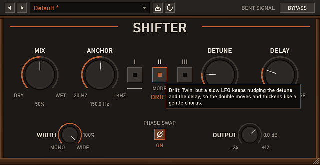

# Shifter

*Makes one note sound like two, and a little bit wrong in the good way.*

Shifter is a stereo micro-pitch doubler for Windows VST3 hosts. It takes a mono or stereo signal, copies it, detunes the copies by a few cents in opposite directions, nudges them apart in time, and spreads them across the stereo field. The result is the classic "double-tracked" thickness and width you'd normally get by recording a part twice, without recording it twice.

It ships with its own Win32 editor, a handful of presets, and a per-machine MSI. The DSP lives in the `soundcraft-dsp` crate; this repo is the plugin wrapper and the UI.

## What it actually does

Each channel runs through a short delay and a pitch shifter built from two grain taps crossfaded against each other (a "rotating head"). The left channel's voice is pitched up, the right channel's voice is pitched down, so the two sides drift apart in pitch by twice the Detune amount. Because the pitch shift is done with a ~20 ms grain window, the wet signal arrives roughly 10 ms late on top of whatever Delay you set. That lag is part of the sound, so there is no latency compensation (the plugin reports 0 samples).

The low end is protected by the Anchor frequency. Everything below it is routed through the dry path, so kick and bass stay centred and in tune while the top end gets wider and busier.

## Modes

- **Twin**: a static doubler. Left voice tuned up, right voice tuned down, the right voice sitting at 70% of the delay. Classic, slightly bright, wide.
- **Drift**: Twin with a slow LFO (about 0.23 Hz) wandering the detune between 0.5x and 1.5x and the delay by ±10%. Reads as a gentle chorus that never quite repeats.
- **Spread**: mid/side. The difference between the two voices is added to the sides only, so the centre stays exactly dry. The effect cancels in a mono sum, so it's safe for mono playback and mono club systems. Right voice sits at 160% of the delay.

Mode changes crossfade, so you can switch while playing without clicks.

## Controls

| Control | Range | Default | What it does |
|---|---|---|---|
| Mode | Twin / Drift / Spread | Twin | See above |
| Delay (ms) | 0–50 | 12 | Offset of the detuned voices behind the dry signal |
| Detune (ct) | 0–50 | 9 | Pitch offset per voice (up left, down right) |
| Anchor (Hz) | 20–1000, log | 150 | Content below this stays centred and undetuned |
| Width (%) | 0–100 | 100 | Stereo separation of the two voices. 0 puts both centred |
| Mix (%) | 0–100 | 50 | Dry/wet balance. In Spread, the amount of side signal added |
| Output (dB) | −24 to +12 | 0 | Final gain |
| Phase Swap | off/on | off | Flips the right voice's polarity (side signal in Spread). Handy for hollow, phasey tones |
| Bypass | off/on | off | Click-free dry pass-through |

Hover any control in the editor for a short tooltip.

## Presets

| Preset | Mode | Delay | Detune | Anchor | Width | Mix | Output | Phase Swap |
|---|---|---|---|---|---|---|---|---|
| Default | Twin | 12 | 9 | 150 | 100 | 50 | 0 | off |
| Gentle Double | Twin | 8 | 5 | 150 | 100 | 35 | 0 | off |
| Wide Twin | Twin | 18 | 14 | 200 | 100 | 60 | −1 | off |
| Slow Drift | Drift | 15 | 10 | 150 | 100 | 50 | 0 | off |
| Mono-Safe Spread | Spread | 20 | 12 | 180 | 100 | 60 | 0 | off |
| Hollow Swap | Twin | 14 | 9 | 120 | 100 | 50 | 0 | on |

## Notes

- Anchor is the low-end guard. Raise it if bass or kick gets smeared; lower it to let more low end widen.
- Spread leaves the centre dry, so it is the safe choice for material that will be summed to mono later.
- Phase Swap can cancel parts of the signal. Check the mono sum before committing.
## Build

Needs Rust (MSVC toolchain, 1.90+).

    $env:CARGO_TARGET_DIR = "D:\ai\Projects\bt-shifter-build"
    cargo build --release -p soundcraft-shifter-vst3 --lib
    cargo test --workspace
    cargo clippy --workspace --all-targets -- -D warnings

Installer (needs WiX v5: `dotnet tool install --global wix --version 5.0.2`):

    powershell -ExecutionPolicy Bypass -File scripts\package.ps1

Output: `dist\Shifter-VST3-0.1.0-x64.msi`.

## Install

The MSI (per-machine, needs admin) installs the bundle to `C:\Program Files\Common Files\VST3\Shifter.vst3`:

    Shifter.vst3\Contents\x86_64-win\Shifter.vst3
    Shifter.vst3\Contents\Resources\

Or copy the bundle there by hand. Rescan plugins in your host afterwards.

## Status

Version 0.1.0. Built and tested with the workspace test suite and a host-load test; not yet verified in a long list of DAWs. If it misbehaves in your host, open an issue and say which host and version.

## License

Cargo metadata says `MIT OR Apache-2.0`; this README previously said all rights reserved. Pick one and make them agree. (Open question for the owner.)
