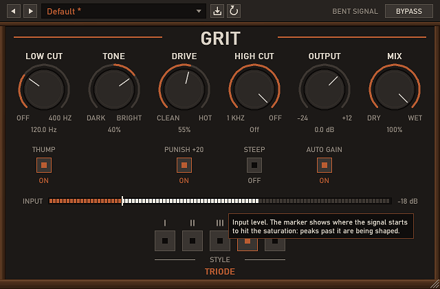

# Grit

A multi-style drive unit. Signal order: Low Cut (optional Thump bump) → Tone tilt → Drive (+ Punish, +20 dB) → one of five shapers (Tape, Germanium, Console, Triode, Pentode) → High Cut (6 or 30 dB/oct) → Output → Mix. With Auto on the output level is matched to the input so more Drive does not get louder. At Drive 0 the wet path equals the input in every style.

Presets: Default, Warm Tape, Triode Glow, Pentode Bite, Germanium Fuzz, Punished Parallel.
