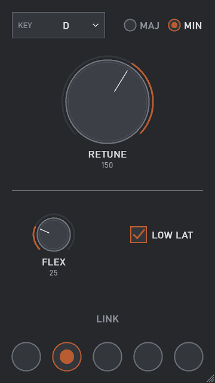

# Plumb

*Pitch correction that stays out of the way. Pick a key, turn one knob.*

Plumb is a realtime, monophonic pitch corrector (vocals, lead lines, any single voice). It tracks the pitch of the input and moves it to the nearest note of the key and scale you choose.

## Controls

| Control | What it does |
|---|---|
| Key | Root note of the scale. |
| Maj / Min | Major or minor scale. Other scales (chromatic, harmonic minor, blues, pentatonics and more) are on the host's parameter list. |
| Retune | How long the move to the target note takes. Slowest (400 ms) is the left end of the wheel and is the most natural; 0 is instant; the far right end (Lock) delays the audio a few ms so every note is on target from its first moment. |
| Flex | How much of the singer's own pitch drift is kept. 0 snaps hard, 100 leaves the pitch as sung. |
| Low Lat | Record mode: tunes with under 1 ms latency so you can monitor through it while recording (a little rougher on low voices, no Lock). |
| Link | Five dots. Plumbs on the same dot share key, scale, retune, flex and mode. Click a lit dot to unlink. Works between Plumbs in the same host process. |
| A4 Hz | Typed box beside Retune (click, type, Enter): the tuning reference, 420-460 Hz. |

Latency is 20 ms in Normal mode (more in Lock), under 1 ms in Low Lat. The editor resizes (drag the corner) and remembers its size.

## How it works

The input is tracked with YIN. The deviation from the nearest note drives a two-stage smooth glide (Retune) and a rotating-head pitch shifter splices back by whole detected periods, so there is no standing comb filter. Unvoiced sounds (breaths, consonants) pass through untouched.

## Matching other tuners

Plumb's Retune number is calibrated to Auto-Tune Pro's Retune Speed (same ms, same 0-400 range): the same number glides the same way, measured with `crates/plumb-vst3/examples/rate.rs` (a synthetic voice stepped +40 ct, plus a 5.5 Hz vibrato) and on a real vocal. At 20, both land 61% of frames within 10 ct of a semitone, the vibrato is about 72-74% kept in both, and 63% of a pitch step is corrected after about 32-34 ms.

Xpitch's Transition knob (0-1) lands, by the same step-response measure, at roughly:

| Xpitch Transition | 0.1 | 0.15 | 0.2 | 0.3 | 0.5 | 0.7 |
|---|---|---|---|---|---|---|
| Plumb / Auto-Tune Retune | 2 | 5 | 12 | 30 | 100 | 190 |

Run it yourself (needs the plugins installed): `rate step`, `rate vib`, or `VOCAL=your.wav rate vocal`.
