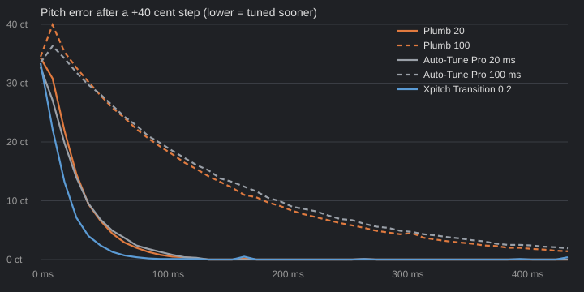

# Plumb vs the competition

Measured offline on one Windows machine with the real VST3s (Auto-Tune Pro, Xpitch) loaded in the same test host as Plumb. Reproduce with `crates/plumb-vst3/examples/rate.rs` (`rate step`, `rate vib`, `rate trace`, `VOCAL=your.wav rate vocal`). These are measurements of pitch behaviour, not a verdict on sound quality: I have not blind-listened to them, and you should.

## Pitch step

A synthetic voice sits on E4, then goes 40 cents sharp, then back, repeatedly. The plot is the output's pitch error after one step.

Time for the correction to take out 63% / 90% of the step (ms):

| Retune | Plumb 63% | Auto-Tune Pro 63% | Plumb 90% | Auto-Tune Pro 90% |
|---|---|---|---|---|
| 10 | 20 | 18 | 36 | 39 |
| 20 | 34 | 32 | 67 | 70 |
| 30 | 50 | 51 | 99 | 109 |
| 50 | 81 | 87 | 165 | 182 |
| 100 | 159 | 169 | 324 | 353 |

Plumb's numbers are calibrated to Auto-Tune Pro's Retune Speed, so the same number gives about the same glide.

## Vibrato (5.5 Hz, +-35 cents)

Share of the vibrato that survives the correction (higher = more natural, less flattened):

| Retune | Plumb | Auto-Tune Pro |
|---|---|---|
| 5 | 39% | 42% |
| 10 | 52% | 54% |
| 20 | 74% | 72% |
| 30 | 86% | 84% |
| 50 | 95% | 92% |
| 100 | 99% | 97% |

## A real vocal (30 s, chromatic, flex 0)

| Retune | Plumb within 10 ct | Auto-Tune Pro within 10 ct | Plumb median error | Auto-Tune Pro median error |
|---|---|---|---|---|
| 10 | 69% | 69% | 5.4 ct | 5.1 ct |
| 15 | 65% | 64% | 6.5 ct | 6.2 ct |
| 20 | 61% | 61% | 7.3 ct | 7.1 ct |
| 30 | 56% | 55% | 8.3 ct | 8.5 ct |
| 50 | 51% | 50% | 9.8 ct | 10.0 ct |

The untuned vocal is within 10 ct on 22% of frames.

## Xpitch

Xpitch's Transition knob (0-1) lands at about the same step response as Retune 2, 5, 12, 30, 100 and 190 for Transition 0.1, 0.15, 0.2, 0.3, 0.5 and 0.7. Xpitch reports 0 latency but delays the audio by about 35 ms in the test host; Plumb reports its real latency (20 ms normal, under 1 ms in Low Lat mode).

## Not covered

Formant handling, sound quality on breaths and consonants, polyphonic material, and anything Auto-Tune Pro does that Plumb doesn't (graph mode, MIDI target notes, vibrato generator). Plumb is monophonic only.
